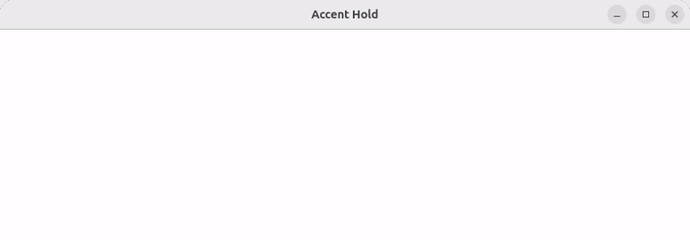

# Accent Hold

*Lire dans une autre langue : [English](README.md)*

> **Tapez les caractères accentués en maintenant la lettre.**
> Maintenez `e`, `a`, `c`, `o`, `n` … et ses variantes (`é è ê ë`, `ç`, `ñ`,
> `ô` …) apparaissent dans une petite fenêtre ; une frappe normale tape la
> lettre. Un raccourci (`Super+E`) ouvre le même sélecteur sans maintenir.
> Extension GNOME Shell pure (Wayland) : aucun daemon, aucun privilège,
> aucune dépendance, installable en un clic depuis extensions.gnome.org.



## Utilisation

**Appui long** (champs texte, éditeurs, terminaux) :

1. maintiens une lettre : `e`, `a`, `c`, `o`, `u`, `n`, `s`, `i`, `y`, `z`
2. choisis la variante : `1`–`9` (par position de touche, donc ça marche en
   AZERTY, QWERTZ…), ou déplace-toi avec `←`/`→` puis `Entrée`, ou clique.

`Entrée` choisit la variante surlignée (la première tant qu'on ne bouge pas).
Tout le reste garde la lettre simple : `Échap`, `Espace`, ou simplement
continuer à taper. `E` (avec Maj) propose `É È Ê Ë …`.

**Raccourci**, quand on préfère ne pas maintenir :

1. `Super+E` (configurable)
2. tape une lettre de base
3. choisis la variante de la même façon (ici `Espace` choisit aussi).

## Où ça marche

Les deux gestes passent par la méthode de saisie de GNOME : ils marchent
dans les applications qui l'utilisent sous Wayland — les applications GTK 3
et GTK 4 et les terminaux VTE (Console, Ptyxis, GNOME Terminal) sont ce que
l'auteur utilise et teste. Firefox, les applications Electron lancées
avec leur backend Wayland et les applications Qt 6 récentes (vérifié avec
Qt 6.11) parlent le même protocole mais n'ont pas été testés aussi à fond.
Les applications Qt 5 embarquent leur propre client IBus et la contournent,
et les applications XWayland ne sont pas couvertes : utilisez-y le
raccourci. L'extension ne fait rien en session X11.

La fenêtre s'ouvre sous le curseur de texte quand l'application le signale
(GTK le fait), sinon sous le pointeur de la souris, et toujours à
l'intérieur de l'écran.

**À propos de la répétition.** La lettre maintenue ne doit pas devenir
`eeee`. Sur GNOME 49 et 50 avec les applications qui utilisent le nouveau
protocole de répétition (wl_keyboard v10 : GTK récent), c'est le Shell qui
répète et l'extension avale les répétitions. Partout ailleurs (GNOME 45–48,
et les applications plus anciennes sur toute version), l'application répète
d'elle-même : l'extension lui signale que la touche est relâchée dès que les
variantes apparaissent, soit avec les 400 ms par défaut avant la première
répétition (500 ms), et si des lettres sont quand même passées elle les
supprime quand l'application rapporte le texte autour du curseur (GTK le
fait ; pas les terminaux, où un seul Retour arrière est envoyé). Vérifié
sur GNOME 50 et 51 et sur les sources de Mutter et GNOME Shell 45–50, pas
en exécutant 45–49.

**Versions.** `metadata.json` déclare GNOME 45 à 51. L'auteur utilise 51 ;
les deux différences d'API avec 45 (`getSurroundingText()` à deux valeurs,
pas de `findMonitorForPoint()`) sont traitées explicitement, mais rien
d'autre que 50 et 51 n'a été exécuté.

## Installer

### Pour un utilisateur (le plus simple)
Sur [**extensions.gnome.org**](https://extensions.gnome.org/extension/10265/accent-hold/), clique **« Install »**. Pas de terminal, pas de sudo,
pas de daemon.

### Construire le paquet à uploader
```bash
./pack.sh
```
Génère `accent-hold@griffit.gmail.com.shell-extension.zip` à la racine du dépôt,
prêt à être déposé sur <https://extensions.gnome.org/upload/>.

### En local (dev)
```bash
gnome-extensions install --force accent-hold@griffit.gmail.com.shell-extension.zip
# déconnexion/reconnexion (Wayland), puis :
gnome-extensions enable accent-hold@griffit.gmail.com
```

## Préférences

Panneau de configuration intégré (icône réglages dans l'app *Extensions*, ou
`gnome-extensions prefs accent-hold@griffit.gmail.com`) :

- **Appui long** : activer ou non (`press-and-hold`), durée d'appui
  (`hold-ms`, 400 ms par défaut), et choix de la variante surlignée en
  relâchant la lettre (`pick-on-release`, désactivé par défaut).
- **Raccourci** : la touche qui ouvre le sélecteur (`accent-hold-shortcut`,
  défaut `Super+E` ; un modificateur ou une touche de fonction est exigé),
  et son interrupteur (`enabled`, qui ne concerne que le raccourci).
- **Délai (ms)** : latence avant l'affichage du sélecteur du raccourci
  (`delay-ms`, 0–1000 ; sans effet sur l'appui long).
- **Fermeture automatique** : garde-fou après lequel toute fenêtre se ferme
  (`popup-timeout-ms`).
- **Caractères** : table des variantes (`accents`, JSON : un objet qui
  associe une lettre à une liste de variantes ; mal formé = table intégrée).
- **Claviers** : dispositions xkb où l'appui long et le raccourci sont actifs
  (`layouts`, vide = toutes).
- **Icône dans la barre du haut** : une icône dont le menu met toute
  l'extension en pause, ouvre les préférences ou masque l'icône
  (`show-indicator`, masquée par défaut depuis la 2.5).

Tout est stocké dans GSettings
(`org.gnome.shell.extensions.accent-hold`). En CLI :
```bash
gsettings set org.gnome.shell.extensions.accent-hold accent-hold-shortcut "['<Super>grave']"
```

## Moteur IBus optionnel (applications X11)

Pour les anciennes applications X11, le moteur [`ibus/`](ibus/) offre le
même geste via IBus. La plupart des gens n'en ont pas besoin.

```bash
curl -L https://github.com/d101c/accent-hold/archive/refs/tags/v2.0.tar.gz | tar xz
accent-hold-2.0/ibus/install.sh --replace
```
Depuis un clone : `./ibus/install.sh --replace` (ou `--add-source`). Il faut
les bindings Python d'IBus, déjà présents sur la plupart des bureaux GNOME
(sinon `sudo apt install python3-gi gir1.2-ibus-1.0`, ou `sudo dnf install
python3-gobject ibus`).

Sans `sudo`. Une source de saisie est générée par disposition clavier utilisée
(« Français (Accent Hold) », « Anglais (Accent Hold) »…). Quand l'une d'elles
est sélectionnée, l'extension laisse les touches au moteur. Désinstallation :
`./ibus/uninstall.sh`.

Fonctionnement : l'installeur ajoute une petite option xkb
(`accenthold:norepeat`, fichiers dans `~/.config/xkb`) qui marque seulement
les lettres accentuables (a, e, i, o, u, c, n, y, s, z de vos dispositions)
comme « sans répétition ». Une lettre maintenue tape un seul caractère et
ouvre le sélecteur au lieu de `eeee` ; les flèches, Suppr, les touches de
volume et toutes les autres gardent la répétition native du bureau.
Relancez l'installeur après avoir ajouté une disposition.

Les préférences (table d'accents, délai) s'ouvrent depuis le menu des sources
de saisie de GNOME (« fr » dans la barre du haut) › *Préférences Accent
Hold…* : avec le moteur, l'icône propre de l'extension peut être masquée.

## Fonctionnement de l'appui long

Sous Wayland, la méthode de saisie de GNOME Shell voit chaque touche tapée
dans un champ texte avant de la passer à IBus. L'extension enveloppe cet
appel (`IBus.InputContext.prototype.process_key_event_async`, seulement
tant que l'appui long est activé) et observe les touches : une lettre tapée
passe telle quelle ; une lettre accentuable maintenue ouvre les variantes,
et la variante choisie remplace la lettre déjà tapée (`delete_surrounding`
quand l'application rapporte son texte, sinon un Retour arrière). Seuls les
chiffres, les flèches, `Échap` et `Entrée`
sont retenus pendant l'affichage des variantes. Les touches mortes
composent avant que l'extension voie la lettre : maintenir `e` après `´`
remplace le `é` composé. Dans un terminal avec des modes (vim), le Retour
arrière arrive à l'application comme n'importe quelle touche.

Le sélecteur du raccourci prend une capture modale le temps de la lettre et
du choix, puis commet le caractère par la même méthode de saisie.
L'ancienne variante daemon evdev est archivée dans [`legacy/`](legacy/).

## Alternative zéro-install : la touche Compose

Sans rien installer, GNOME sait déjà taper les accents partout :
```bash
gsettings set org.gnome.desktop.input-sources xkb-options "['compose:caps']"
```
Puis `Compose`(Verr.Maj) `e` `'` → é. Pas de popup, mais zéro dépendance.

## Comment il a été fait

Accent Hold a été développé avec une aide importante d'un assistant de code
IA (Claude, d'Anthropic), qui a écrit l'essentiel du code. L'auteur a choisi
les fonctions et l'approche, relu les modifications, testé chaque version à la
main sous GNOME 50 (AZERTY et QWERTY), et maintient le projet. La machine à
états de l'appui long, l'enveloppe du prototype, le placement des fenêtres
et l'analyse de la table sont couverts par des tests gjs
(`extension/tests/run.sh` ; `pytest ibus/tests` pour le moteur). La version
2.2 fait suite à une relecture de code indépendante dont les constats sont
listés dans la pull request. Les rapports de bug sont lus et traités par un
humain.

## Crédits

La technique d'appui long (lettre maintenue empêchée de se répéter, lettre
remplacée après coup) vient de
[gnome-accent-hold](https://github.com/manux81/gnome-accent-hold) de
**Manuele Conti**. Merci ! L'extension et le moteur IBus en sont des
implémentations indépendantes.

## Licence

[GPL-2.0-or-later](LICENSE).
