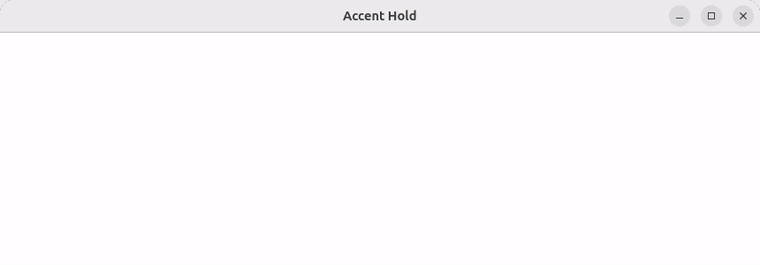

# Accent Hold

*Read this in another language: [Français](README.fr.md)*

> **Type accented and special characters by holding the letter.**
> Hold `e`, `a`, `c`, `o`, `n` … and its accented variants (`é è ê ë`, `ç`, `ñ`,
> `ô` …) appear in a small popup; tap the letter and it types normally.
> A shortcut (`Super+E`) opens the same picker without holding. Pure GNOME
> Shell extension (Wayland): no daemon, no privileges, no dependencies,
> one-click install from extensions.gnome.org.



## Usage

**Press and hold** (text fields, editors, terminals):

1. hold a letter: `e`, `a`, `c`, `o`, `u`, `n`, `s`, `i`, `y`, `z`
2. pick the variant: `1`–`9` (by key position, so it works on AZERTY,
   QWERTZ …), or move with `←`/`→` and press `Enter`, or click.

`Enter` picks the highlighted variant (the first one until you move).
Anything else keeps the plain letter: `Esc`, `Space`, or just typing on.
`E` (with Shift) offers `É È Ê Ë …`.

**Ways to pick a variant.** The default is the macOS one: the variants stay
open after you let go of the letter, and `Enter`, a number or a click picks.
Other ways are options in the preferences, off by default, so nothing changes
unless you turn them on:

- **Pick on release** (*Press and hold*): the variants open with nothing
  highlighted; `←`/`→` (or `Tab`) highlight one while you keep the letter
  held, and letting go of the letter picks it. Letting go without moving
  keeps the plain letter. A number still picks while the letter is held. The
  variants close on release, so the mouse is not used in this mode.

**Shortcut**, when you would rather not hold:

1. `Super+E` (configurable)
2. type a base letter
3. pick the variant the same way (here `Space` picks too).

## Where it works

Press and hold goes through the GNOME input method, so it works in
applications that use it on Wayland: GTK 3 and GTK 4 applications, VTE
terminals (GNOME Console, Ptyxis, GNOME Terminal), Firefox and Thunderbird,
Chromium and Electron applications running with their Wayland backend, and
recent Qt 6 applications, Qt WebEngine included (checked with Qt 6.11 and
6.12).

Applications that do not use it never show the press-and-hold popup: Qt 5
applications (they bring their own IBus client) and XWayland applications,
which is how many Electron applications still run (Teams, for one).
There, use the shortcut: when the focused application has no input method,
the picker pastes the chosen character (clipboard, `Shift+Insert`) and puts
the previous clipboard content back right after. An Electron application
started with `--ozone-platform=wayland` gets press and hold too. The
extension does nothing on X11 sessions.

The popup opens below the text cursor when the application reports it
(GTK does), otherwise below the mouse pointer, and always inside the
monitor.

**About key repeat.** The held letter must not turn into `eeee`. On GNOME
49 and 50 with applications that use the new repeat protocol (wl_keyboard
v10: current GTK), the Shell repeats the key and the extension swallows the
repeats. Everywhere else (GNOME 45–48, and older application builds on any
version) the application repeats the key on its own: the extension tells it
the key is up as soon as the variants appear, which with the default 400 ms
hold is before the first repeat (500 ms), and if some letters got in
anyway it deletes them when the application reports its text around the
cursor (GTK does; terminals do not, there one BackSpace is sent). This was
checked on GNOME 50 and 51 and against the Mutter and GNOME Shell sources
for 45–50, not by running 45–49.

**Versions.** `metadata.json` lists GNOME 45 to 51. The author runs 51; the
two API differences with 45 (`getSurroundingText()` returning two values,
no `findMonitorForPoint()`) are handled explicitly, but nothing below 50
has been run.

## Install

### For a user (the simplest way)
On [**extensions.gnome.org**](https://extensions.gnome.org/extension/10265/accent-hold/), click **“Install”**. No terminal, no sudo,
no daemon.

### Build the package to upload
```bash
./pack.sh
```
Produces `accent-hold@griffit.gmail.com.shell-extension.zip` at the repo root,
ready to be submitted at <https://extensions.gnome.org/upload/>.

### Locally (dev)
```bash
gnome-extensions install --force accent-hold@griffit.gmail.com.shell-extension.zip
# log out / log back in (Wayland), then:
gnome-extensions enable accent-hold@griffit.gmail.com
```

## Preferences

Built-in settings panel (the settings icon in the *Extensions* app, or
`gnome-extensions prefs accent-hold@griffit.gmail.com`):

- **Press and hold** — on/off (`press-and-hold`), how long a letter must
  be held (`hold-ms`, default 400 ms), and whether releasing it picks the
  highlighted variant (`pick-on-release`, off by default).
- **Shortcut** — the key that opens the picker (`accent-hold-shortcut`,
  default `Super+E`; a modifier or a function key is required), and its
  on/off switch (`enabled`, which only affects the shortcut).
- **Delay (ms)** — latency before the shortcut picker appears (`delay-ms`,
  0–1000; does not apply to press and hold).
- **Auto-close** — failsafe after which any popup closes (`popup-timeout-ms`).
- **Presets** — ready-made tables (French, Spanish, Portuguese, Italian,
  German, Nordic, Polish, Czech and Slovak, Turkish, Romanian, typography and
  currency symbols) to load in one click, your own tables saved under a name
  (`user-presets`), and import / export as a plain JSON file to share them:
  `{"name": "Norwegian", "accents": {"a": ["å", "æ"], "o": ["ø"]}}`. A bare
  table is accepted too. Loading a preset only fills the editor below, so you
  can adjust it afterwards; if your edits are saved nowhere, you are asked
  before they are replaced.
- **Characters** — table of accented variants (`accents`, JSON: an object
  mapping a letter to a list of variants; malformed = built-in table), one
  line per letter, with a button to edit it in a larger window.
- **Keyboards** — xkb layouts where press and hold and the shortcut are
  active (`layouts`, empty = all).
- **Top bar icon** — an icon whose menu pauses the whole extension, opens
  the preferences or hides the icon (`show-indicator`, off by default since
  2.5).

Everything is stored in GSettings
(`org.gnome.shell.extensions.accent-hold`). From the CLI:
```bash
gsettings set org.gnome.shell.extensions.accent-hold accent-hold-shortcut "['<Super>grave']"
```

## Optional IBus engine (X11 applications)

For older X11 applications, the [`ibus/`](ibus/) engine offers the same
gesture through IBus. Most people do not need it.

```bash
curl -L https://github.com/d101c/accent-hold/archive/refs/tags/v2.0.tar.gz | tar xz
accent-hold-2.0/ibus/install.sh --replace
```
From a clone, run `./ibus/install.sh --replace` (or `--add-source`). It needs
the IBus Python bindings, already there on most GNOME desktops (otherwise
`sudo apt install python3-gi gir1.2-ibus-1.0`, or `sudo dnf install
python3-gobject ibus`).

No `sudo`. One input source is generated per keyboard layout you use
(“French (Accent Hold)”, “English (Accent Hold)”, …). While one of them is
selected, the extension leaves the keys to the engine. Remove it with
`./ibus/uninstall.sh`.

How it works: the installer adds a small xkb option (`accenthold:norepeat`,
files in `~/.config/xkb`) that marks only the accentable letters (a, e, i, o,
u, c, n, y, s, z on your layouts) as non-repeating. A held letter types one
character and opens the picker instead of `eeee`; arrows, Delete, volume
keys and every other key keep the desktop's native repeat. Re-run the
installer after adding a layout.

The preferences (accent table, delay) open from GNOME's input source menu
(“fr” in the top bar) › *Accent Hold Preferences…*, so with the engine you can
hide the extension's own icon.

## How press and hold works

On Wayland, GNOME Shell's input method sees every key typed into a text
field before passing it to IBus. The extension wraps that call
(`IBus.InputContext.prototype.process_key_event_async`, only while press
and hold is on) and watches the keys: a tapped letter goes through
untouched; a held accentable letter opens the variants, and the chosen
variant replaces the letter already typed (`delete_surrounding` when the
application reports its text, else one BackSpace). Only digits, arrows,
`Esc` and `Enter` are kept back while the variants
are shown. Dead keys compose before the extension sees the letter, so
holding `e` after `´` replaces the composed `é`. In a terminal application
with modes (vim), the BackSpace goes to the application like any key.

The shortcut picker takes a modal grab for the letter and the choice, then
commits the character through the same input method, or pastes it when the
application has none (see above). The old evdev daemon
variant is archived in [`legacy/`](legacy/).

## Zero-install alternative: the Compose key

Without installing anything, GNOME can already type accents everywhere:
```bash
gsettings set org.gnome.desktop.input-sources xkb-options "['compose:caps']"
```
Then `Compose`(Caps Lock) `e` `'` → é. No popup, but zero dependencies.

## How it was made

Accent Hold was developed with substantial help from an AI coding assistant
(Claude, by Anthropic), which wrote most of the code. The author chose the
features and the approach, reviewed the changes, tested every version by hand
on GNOME 50 (AZERTY and QWERTY), and maintains the project. The press-and-hold
state machine, the prototype wrapping, the popup placement and the table
parsing are covered by plain-gjs tests (`extension/tests/run.sh`; `pytest
ibus/tests` for the engine). Version 2.2 followed an independent code review
whose findings are listed in the pull request. Bug reports are read and
answered by a human.

## Credits

The press-and-hold technique (the held letter kept from repeating, letter
replaced after the fact) comes from **Manuele Conti**'s
[gnome-accent-hold](https://github.com/manux81/gnome-accent-hold). Thank you!
The extension and the IBus engine are independent implementations.

## License

[GPL-2.0-or-later](LICENSE).
