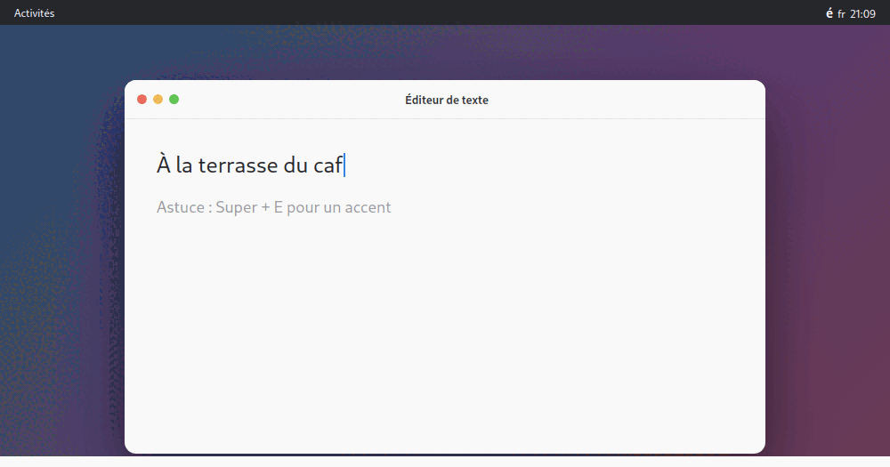

# Accent Hold

*Read this in another language: [Français](README.fr.md)*

> **Type accented and special characters the macOS way — without a daemon or root.**
> Press a configurable shortcut, type a base letter (`e`, `a`, `c`, `o`, `n` …),
> then pick the accented variant you want (`é è ê ë`, `ç`, `ñ`, `ô` …) from a clean
> popup. The chosen character is injected wherever your cursor is — text fields,
> editors and the terminal included. A built-in preferences panel lets you customize
> the shortcut, the popup delay, the character table and the active keyboard layouts.
> Pure GNOME Shell extension — no daemon, no privileges, no dependencies, one-click
> install from extensions.gnome.org.



## Usage

1. `Super+E` (configurable shortcut)
2. type a base letter: `e`, `a`, `c`, `o`, `u`, `n`, `s`, `i`, `y`, `z`
3. pick the variant: `1`–`9`, or `←`/`→` + `Enter`, or click. `Esc` cancels.

The character is inserted into the field that had focus (terminal included).
Shift is detected: `E` offers `É È Ê Ë …`.

## Install

### For a user (the simplest way)
On **extensions.gnome.org**, click **“Install”**. Done. No terminal, no sudo,
no daemon — it is a pure Shell extension.

### Build the package to upload
```bash
./pack.sh
```
Produces `accent-hold@griffit.gmail.com.shell-extension.zip` at the repo root,
ready to be submitted at <https://extensions.gnome.org/upload/>.

### Locally (dev)
```bash
gnome-extensions install --force accent-hold@griffit.gmail.com.shell-extension.zip
# log out / log back in (Wayland), then:
gnome-extensions enable accent-hold@griffit.gmail.com
```

## Preferences

Built-in settings panel (the settings icon in the *Extensions* app, or
`gnome-extensions prefs accent-hold@griffit.gmail.com`):

- **Shortcut** — the key that opens the picker (default `Super+E`).
- **Enable / disable** — turns the shortcut off without uninstalling the extension.
- **Delay (ms)** — latency before the popup appears (0–1000).
- **Characters** — table of accented variants (JSON), overridable.
- **Keyboards** — list of xkb layouts where the extension is active (empty = all).

Everything is stored in GSettings
(`org.gnome.shell.extensions.accent-hold`). From the CLI:
```bash
gsettings set org.gnome.shell.extensions.accent-hold trigger "['<Super>grave']"
```

## True press-and-hold mode (IBus engine)

Prefer the macOS gesture? The [`ibus/`](ibus/) engine gives you **real
press-and-hold**: tap a letter and it types normally; hold it and the
candidates appear **next to the text cursor**. Pick one with `1`–`9` (by key
position, so it works on AZERTY, QWERTZ, …), the arrows + `Enter`, or the
mouse. `Esc` keeps the plain letter.

```bash
./ibus/install.sh --add-source
```

No `sudo`. One input source is generated per keyboard layout you use
(“French (Accent Hold)”, “English (Accent Hold)”, …): same layout, plus
accents. `--add-source` adds it next to your layout (switch with
`Super+Space`); `--replace` swaps your layouts for their Accent Hold version,
so accents work everywhere with nothing to pick. It reads the same accent table as the extension's preferences.
Remove it with `./ibus/uninstall.sh`.

How it works: the installer adds a small xkb option (`accenthold:norepeat`,
files in `~/.config/xkb`) that marks only the accentable letters (a, e, i, o,
u, c, n, y, s, z on your layouts) as non-repeating, like macOS does. A held
letter types one character and opens the picker instead of `eeee`; arrows,
Delete, volume keys and every other key keep the desktop's native repeat,
everywhere. Re-run the installer after adding a layout.

The preferences (accent table, delay) open from GNOME's input source menu
(“fr” in the top bar) › *Accent Hold Preferences…*, so with the engine you can
hide the extension's own icon.

## Why does the extension use a shortcut?

A GNOME Shell extension cannot see a letter being held inside another
application on Wayland, so the extension uses a global shortcut captured by the
Shell: one-click install, nothing else. For the hold gesture, use the IBus
engine above. The old evdev daemon variant is archived in [`legacy/`](legacy/).

## Zero-install alternative: the Compose key

Without installing anything, GNOME can already type accents everywhere:
```bash
gsettings set org.gnome.desktop.input-sources xkb-options "['compose:caps']"
```
Then `Compose`(Caps Lock) `e` `'` → é. No popup, but zero dependencies.

## Credits

The press-and-hold technique used by the IBus engine (the held letter kept
from repeating, letter replaced after the fact, native IBus candidate panel)
comes from **Manuele Conti**'s
[gnome-accent-hold](https://github.com/manux81/gnome-accent-hold). Thank you!
Our engine is an independent implementation; it stops only the accentable
keys repeating through the keymap instead of switching repeat off globally.

## License

[GPL-2.0-or-later](LICENSE).
